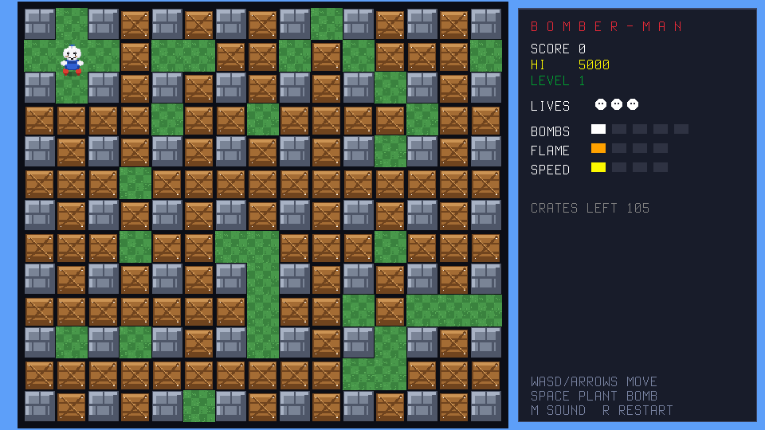

# Bomber-Man (Tyro Game Engine)

A classic grid blast-'em-up for kids, built for Tyro using RayLib, Sprites, a native Tilemap, and Lua.



## Overview

Drop bombs, blast the wooden crates, grab the hidden power-ups, and clear every
level's crates before the fuse of your own greed burns you! A homage to the
1985 Hudson Soft classic with a bright, kid-friendly pixel-art style.

## Key Features

- **Classic Board**: 15x13 grid rendered with the native Tyro tilemap
  (grass / indestructible stone / destructible crates) at smooth 1.25 scale.
- **Grid Bombs & Chain Reactions**: fuse-pulse sprites, cross flames with
  center/arm/tip animated pieces, chain detonation of nearby bombs.
- **Hidden Power-ups under Crates**: FLAME (bigger blasts), BOMB (more bombs),
  SPEED (roller skates), SHIELD (one free hit), and bonus points.
- **Classic Feel Movement**: corner auto-align, stand-on-your-own-bomb
  stand-off logic, spawn protection blink.
- **Level Progression**: clear all crates to advance; escalating boards.
- **Juice**: screen shake, floating combat text, wavetable SFX fallbacks
  (`Pew`, `Explode`, `Zap`, `Coin`, `Chime`, `Sweep`), hi-score persistence.

## Controls

| Action | Keyboard |
|---|---|
| **Move** | `W A S D` / Arrow Keys |
| **Place Bomb** | `SPACE` |
| **Sound On/Off** | `M` |
| **Restart Run** | `R` |
| **Title / Quit** | `ESC` |

## Architecture

- `bomberman.tyro`: Main game script driven by `update(dt)` / `draw()`, with
  sprite pooling, tilemap board, HUD side panel, and audio.
- `bomberman_data.tyro`: Pure rules module (board generation, blast geometry,
  hidden-item rolls, movement collision) — verified by
  `tests/test_bomberman_data.tyro`.
- `make_assets.py`: Standalone Python script using Pillow to generate all
  pixel-art sprite atlases (`.sprite` + `.png`) and the 32x32 tileset.
- Drop an empty `attract.txt` beside the script to skip the title screen (QA).

## Running

```bash
tyro games/bomberman/bomberman.tyro
```
