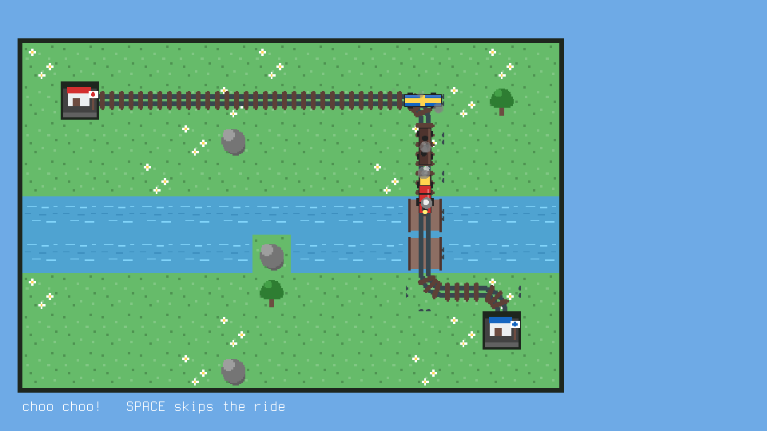

# Choo-Choo Express (Tyro Game Engine)

A top-down railroad puzzle for kids, built for Tyro using RayLib, sprites, a
native Tilemap, and Lua.



## Overview

Lay rail pieces from a limited crate to connect the red station to the blue
one before the departure clock runs out - then watch your train ride the
route, smoke and all. A gentle puzzle about track planning: straights and
curves are easy, junctions trick the straight-first train, rivers want
bridges, and a nose against a closed flank means the rails would smash.

## Key Features

- **Build Phase**: grid board (native Tyro tilemap ground + pooled rail
  overlay sprites), ghost preview tinted green/red with the real deny reason
  (`flood`, `dry`, `rock`, `station`, `smash`), click to lay, right-click to
  lift with refund, limited stock per piece.
- **Five Levels**: First Line, River Bend, Stony Pass, The Y Split (the
  solver's junction turn saves a route the plain walk cannot) and Canal
  Town (two-cell bridge crossing) - all solvability-tested.
- **The Ride**: the engine leads a breadcrumb trail, wagons follow at fixed
  distance and bend smoothly through curves; chuffs and smoke puffs march
  with the wheel distance; the platform jolts and the earnings float up on
  arrival.
- **Departure Clock**: ticking last ten seconds, whistle on departure, score
  = rails x 10 + seconds x 2, hi-score persisted in `choochoo.hi`.
- **All art painted by Lua**: `make_assets.tyro` draws every pixel with the
  engine's own `images` canvas and saves it with the new `images.save` /
  `images.savesprite` engine calls (see `help/drawing.md`).
- **Wavetable-only SFX** (`Pew`, `Zap`, `Chime`, `Coin`, `Sweep`, `Chime`
  whistle), mute with `M`.

## Controls

| Action | Keyboard / Mouse |
|---|---|
| **Pick piece** | `1`..`5` or click the panel |
| **Rotate** | `R` |
| **Lay / lift rail** | left click / right click |
| **Depart!** | `SPACE` (also skips the ride) |
| **Next level** | `N` |
| **Sound On/Off** | `M` |
| **Title / Quit** | `ESC` |

## Architecture

- `choochoo.tyro`: Main game script driven by `update(dt)` / `draw()` -
  splash/title/build/run/score states, tilemap board, sprite pools, ghost
  preview, ride animation along a cell-centre polyline, particles, HUD.
- `choochoo_data.tyro`: Pure rules module (port masks, terrain and smash
  placement rules, the straight-first walk, the backtracking solver, five
  levels, scoring) - verified by `tests/test_choochoo_data.tyro` and
  `tests/test_choochoo_levels.tyro`.
- `make_assets.tyro`: Paints the tile atlas (20 frames), the ground strip
  PNG for the tilemap and the 4-frame train, then writes them out with
  `images.save` / `images.savesprite`.
- `probe_build.tyro` / `probe_canal.tyro`: `CHOCHO_TEST` screenshot drivers
  that auto-play levels for QA.

## Running

```bash
tyro games/choochoo/choochoo.tyro
```
