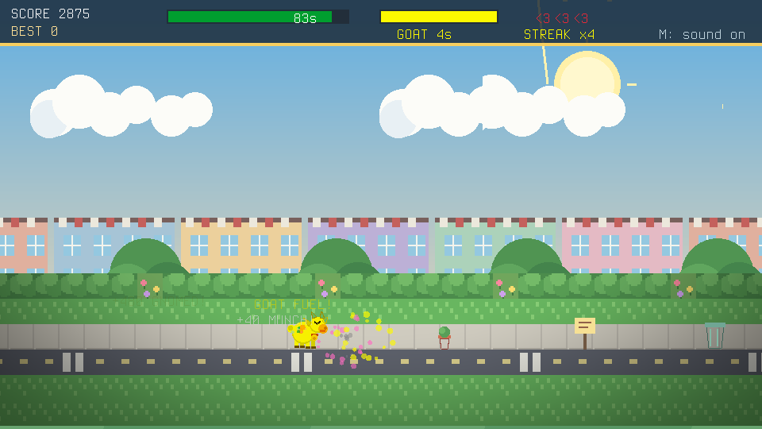

# Goat Rampage 🐐💥

One goat. One town. Ninety seconds. Run down the street, eat the flowers,
headbutt a garden gnome, and send a parked car into orbit. Catch hay bales to
turn into a rainbow goat with double points and no fear of angry dogs.



## Run

From the repository root:

```powershell
bin\tyro.exe games\goatrampage\goatrampage.tyro --workpath=games\goatrampage
```

## Controls

| Action | Keyboard / Gamepad / Mouse |
|---|---|
| Walk | `←` `→` / `A` `D` / left stick |
| Jump | `SPACE` / `W` / `↑` |
| **HEADBUTT** | `X` / `J` / `E` / left mouse / gamepad A |
| Start / restart | `SPACE`, `ENTER`, click, or `R` |
| Pause | `P` (works even while paused) |
| Mute | `M` |
| Exit | `ESC` |

## What it shows off

- **Sprites** — seven hand-painted goat frames (four steps, jump, headbutt,
  dizzy) plus flowers, pots, bins, mailboxes, hydrants, benches, gnomes, cars,
  hay, signs and two dog poses. One sprite per frame, only one visible at a
  time, so there are no per-frame texture uploads.
- **Tiles** — a 16px tileset from `img/tiles.png`, drawn at scale 2. The
  hedge/grass/sidewalk/road strip is a viewport-sized map restamped from the
  scroll position every frame: a tiny grid paints a 6400px town.
- **Parallax** — five repeating layers: sky, clouds, hills, shopfronts and
  trees, each at its own speed.
- **Particles** — hoof dust, smash debris, white impact flashes, star trails
  and the rainbow trail in Goat Mode. All through `particles.emit`; no lists
  of sparks in the game code.
- **Effects** — screen shake on every impact, white flashes, tweened score
  lift, floating comic popups ("GNOMED!", "CRASH!", "YIP! OW!") and a gentle
  vignette in Goat Mode.
- **Sound** — a jaunty two-channel MML loop plus waveform effects for chomps,
  crashes, jumps, bites and pickups. `M` uses the engine's one mute switch.
- **Splash** — the title card goes on the screen buffer before the PNG queue
  starts, so there is no black frame while art loads.
- **High score** — saved in `goatrampage.hi` next to the script.

## Files

| File | Purpose |
|---|---|
| `goatrampage.tyro` | The game: splash, sprites, scroll, gameplay, effects and HUD; driven by `update(dt)` / `draw()`. |
| `goatrampage_data.tyro` | Pure rules: tuning, prop layouts, scoring, MML theme and the high score file. |
| `make_assets.lua` | Paints every PNG in `img/` with `images.*` — no Python or image editor. |
| `img/` | Generated art: five parallax layers, the tileset, goat frames, props and dogs. |

To regenerate the art:

```powershell
New-Item -ItemType Directory -Force games\goatrampage\img | Out-Null
bin\tyro.exe games\goatrampage\make_assets.lua --workpath=games\goatrampage --exit
```

## Testing

The old staged harnesses in `tests/` were retired in the engine-test cleanup.
Run the game itself with its work path so the art and high-score file land in
the game folder:

```powershell
bin\tyro.exe games\goatrampage\goatrampage.tyro --workpath=games\goatrampage --screenshot:12 --exit:13
```

The play test uses the `GOAT_TEST` hook to start a real round, walk, chomp,
smash a car and fill the rampage meter; `--screenshot` catches the result.
