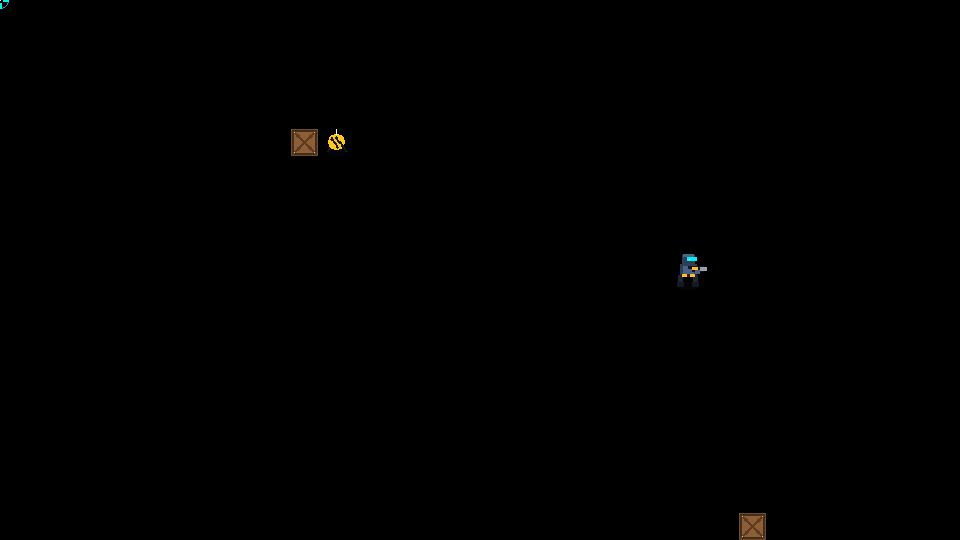

# Maze Rogue (Tyro Game Engine)

A top-down action maze roguelike built for Tyro using RayLib, Sprites, and Lua.



## Overview

Deploy as a heavily armored cyberpunk commando into deep, procedurally generated maze sectors. Purge hostile biomechanical swarms, scavenge energy shields and grenade supplies, and find the portal to delve into deeper and more dangerous sectors.

## Key Features

- **Procedural Maze Generation**: Organic dungeons with interconnecting rooms, corridors, and alternate flanking pathways generated via recursive backtracking.
- **Smooth 4-Way Camera Scrolling**: Camera smoothly tracks the player left, right, up, and down across large labyrinthine sectors.
- **Gunner Recoil / Knockback Physics**:
  - High-velocity dual-plasma blasters.
  - Every shot unleashes real backward impulse momentum against the player, pushing the gunner away from the direction of fire and into tactical positions.
- **Grenades**:
  - Throw fragmentation grenades that bounce off walls with physics arcs.
  - Multi-stage timed fuses with audible beeps.
  - Massive area-of-effect explosions with fiery shockwave animations, heavy screen shake, and knockback against all nearby enemies.
- **Varied Enemy Roster**:
  - **Scuttler**: Fast swarming biomechanical crawler with melee mandibles.
  - **Sentry Drone**: Flying plasma sniper that maintains distance and fires energy bolts.
  - **Kamikaze Beetle**: Glowing suicide bomb bug that sprints at the gunner and detonates on contact.
  - **Heavy Brute**: Armored juggernaut with cybernetic fists and heavy health.
- **Destructibles & Chain Reactions**:
  - **Explosive Barrels**: Red pressurized drums that detonate when shot or caught in blast radiuses, triggering chain reactions.
  - **Supply Crates**: Breakable containers storing health packs, grenade bandoliers, and gems.
- **Full Roguelike Progression**:
  - Health, Shields, Grenade Ammo, Floor Depth, Score, and Kill tracking.
  - Real-time radar / minimap.
  - Descending stairs to deeper floors with escalating difficulty.
  - Native Tyro sound synthesis using waveforms (`Laser`, `Boing`, `Explode`, `Chime`, `HiHat`, `Kick`).

## Controls

| Action | Keyboard / Mouse |
|---|---|
| **Move** | `W`, `A`, `S`, `D` / Arrow Keys |
| **Aim** | Mouse Cursor (Crosshair reticle) |
| **Shoot (Recoil Kick)** | Left Mouse Button / `SPACE` |
| **Throw Grenade** | Right Mouse Button / `G` / `E` / `F` |
| **Restart / Retry** | `R` / `SPACE` |
| **Menu / Pause** | `ESC` |

## Architecture

- `mazerogue.tyro`: Main game script, driven by `update(dt)` / `draw()` callbacks, with sprite pooling, camera damping, audio, and HUD.
- `mazerogue_data.tyro`: Pure mathematical rules module containing maze generation, reachability BFS, recoil calculation, collision resolution, and enemy scaling.
- `make_assets.py`: Standalone Python script using Pillow to generate all pixel-art sprite atlases (`.sprite` + `.png`) and the 32x32 tileset (`tiles.png`).
- `tests/test_mazerogue_data.tyro`: Automated regression tests strictly located in `tests/`.

## Running

```bash
tyro games/mazerogue/mazerogue.tyro
```
