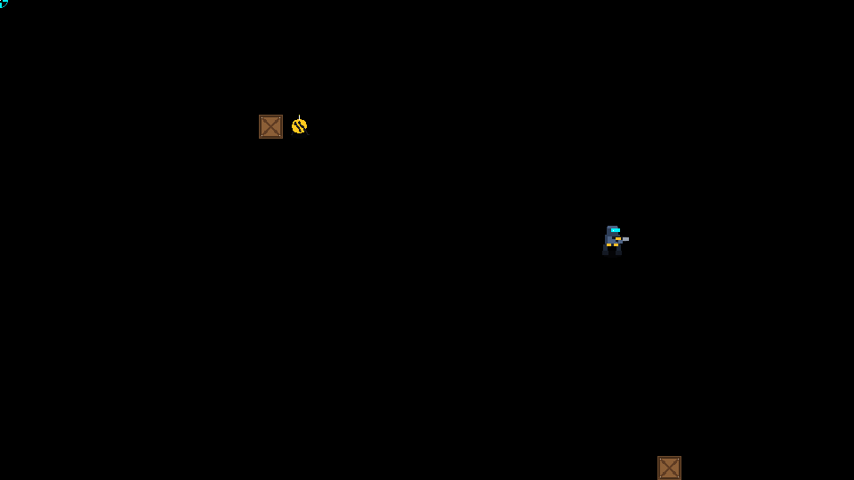

# Maze Rogue (Tyro Game Engine)

A top-down action maze roguelike built for Tyro using RayLib, sprites, and Lua.



## Overview

Deploy as a heavily armored cyberpunk commando into deep, procedurally generated maze sectors. Purge hostile biomechanical swarms, scavenge energy shields and grenade supplies, and find the portal to delve into deeper and more dangerous sectors.

## Key Features

- **Procedural Maze Generation**: Organic dungeons with interconnecting rooms, corridors, and alternate flanking pathways generated via recursive backtracking.
- **Smooth 4-Way Camera Scrolling**: Camera smoothly tracks the player left, right, up, and down across large labyrinthine sectors.
- **Gunner Recoil / Knockback Physics**:
  - High-velocity dual-plasma blasters.
  - Every shot unleashes real backward impulse momentum against the player, pushing the gunner away from the direction of fire and into tactical positions.
- **Grenades**:
  - Throw fragmentation grenades that bounce off walls with physics arcs.
  - Multi-stage timed fuses with audible beeps.
  - Massive area-of-effect explosions with fiery shockwave animations, heavy screen shake, and knockback against all nearby enemies.
- **Varied Enemy Roster**:
  - **Scuttler**: Fast swarming biomechanical crawler with melee mandibles.
  - **Sentry Drone**: Flying plasma sniper that maintains distance and fires energy bolts.
  - **Kamikaze Beetle**: Glowing suicide bomb bug that sprints at the gunner and detonates on contact.
  - **Heavy Brute**: Armored juggernaut with cybernetic fists and heavy health.
  - **Plasma Turret**: Immobile emplacement from sector B-2 upward. Swivels and fires heavy plasma bolts; gun rounds ricochet off its armor - **only bombs (grenades / barrel / kamikaze blasts) destroy it**.
- **Enemy Sight Memory**: Hostiles keep hunting the last position they saw the gunner at for ~3 seconds after he escapes range or breaks line of sight, so ducking behind a wall only buys you a moment.
- **Sector Darkness / Torch Light**: From sector B-2 a custom fragment shader (`flashlight.frag`) drowns the maze in flickering blue night - only the torch ring around the gunner stays lit, and distant sprites fade into silhouettes (explosions and plasma bolts still glow in the dark). The HUD lives on the shader-proof `screen` layer so it stays readable.
  - Tunable in code: `D.LIGHT_RADIUS` (base radius), `D.LIGHT_SHRINK` (tighter each sector), `D.LIGHT_MIN_RADIUS`, `D.DARK_STRENGTH`.
- **Icon HUD**: The top bar carries the bomb ammo and the security key as artwork (`img/grenade.png`, `img/pickup_key.png`) painted straight onto the glass with `screen.image` instead of the `GRENADES:` / `KEY:` words, so the numbers get the room. Being `screen` ink the icons sit above the maze, ignore the torch shader and the camera shake, and the key icon dims to grey until the key is found (`OPEN` / `LOCK`).
- **Radar Uplink Lost Deeper**: The mini-map only works up to sector B-2 (`D.RADAR_MAX_FLOOR`); from B-3 onward you must find the exit on your own.
- **Sector Loading Splash**: Boot and stair-descend show a screen-layer "ENTERING SECTOR" banner while `world.enable = false` keeps the world dark until the new sector's assets are ready (same trick as Jet2026).
- **Destructibles & Chain Reactions**:
  - **Explosive Barrels**: Red pressurized drums that detonate when shot or caught in blast radiuses, triggering chain reactions.
  - **Supply Crates**: Breakable containers storing health packs, grenade bandoliers, and gems.
- **Full Roguelike Progression**:
  - Health, Shields, Grenade Ammo, Floor Depth, Score, and Kill tracking.
  - Real-time radar / minimap.
  - Descending stairs to deeper floors with escalating difficulty.
  - Native Tyro sound synthesis using waveforms (`Laser`, `Boing`, `Explode`, `Chime`, `HiHat`, `Kick`).

## Controls

| Action | Keyboard / Mouse |
|---|---|
| **Move** | `W`, `A`, `S`, `D` / Arrow Keys |
| **Aim** | Mouse Cursor (Crosshair reticle) |
| **Shoot (Recoil Kick)** | Left Mouse Button / `SPACE` |
| **Throw Grenade** | Right Mouse Button / `G` / `E` / `F` |
| **Restart / Retry** | `R` / `SPACE` |
| **Menu / Pause** | `ESC` |

## Architecture

- `mazerogue.tyro`: Main game script, driven by `update(dt)` / `draw()` callbacks, with sprite pooling, camera damping, audio, and HUD.
- `mazerogue_data.tyro`: Pure mathematical rules module containing maze generation, reachability BFS, recoil calculation, collision resolution, enemy scaling, sight memory, and torch-light falloff.
- `flashlight.frag`: Custom GLSL post-processing shader creating the darkness/torch effect on deep sectors (`shader.load`).
- `make_assets.lua`: Generates all pixel-art sprite atlases (`.sprite` + `.png`) and the tileset (`tiles.png`) with Tyro itself — no Python or Pillow. Run `bin\tyro.exe games/mazerogue/make_assets.lua --exit:2`; add `probe` to write `probe_*` files. The older `make_assets.py` is kept for reference only.
- `tests/test_mazerogue_data.tyro`: Automated regression tests strictly located in `tests/`.

## Running

```bash
tyro games/mazerogue/mazerogue.tyro
```
