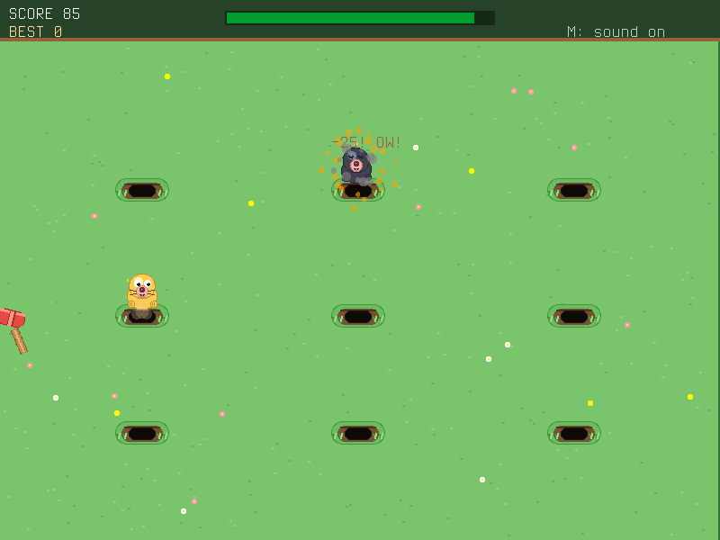

# Whack-a-Mole (Tyro Game Engine)

Nine burrows, one mallet, sixty seconds - bonk the brown moles, feast on the
golden ones, and never ever touch the grumpy bomb-mole.



## Overview

A cheerful circus of moles for kids: the brown ones pay 10 points, golden ones
pay 50 and vanish fast, and the sooty bomb-mole costs you 25 (and your streak)
if you bonk it. A streak of hits raises the multiplier - x2 at three, x3 at
six, x4 at nine - while a whiff at the grass or a greedy bomb hit resets it.
Late in the round the moles pop faster and duck sooner, and up to three ride
out at once.

## Key Features

- **All art painted by the game itself**: `images.new()` sheets draw the
  moles, burrows and mallet at load, and `sprite.fromimage()` installs them -
  no PNG files in the folder at all.
- **Splash loading screen**: the title card goes on the screen buffer before
  the paint shop queues its commands, so it is on glass from the first frame.
- **Mole state machine** (`hidden -> rise -> up -> dizzy/fall`) lives in the
  pure rules module, complete with escape events and a rise fraction the
  sprite layer turns into an overshoot pop.
- **Juice**: dirt puffs, gold sparkles, star particles, screen shake, floating
  score popups, dizzy stars over the bonked mole's head.
- **Circus oom-pah soundtrack** (two-channel MML loop) plus `Pew`, `Kick`,
  `Coin`, `Explode`, `Zap`, `Bee`, `Bell` and `Cash` sound effects, all
  muteable with `M`.
- **Hi-score persistence** in `whackamole.hi`.

## Controls

| Action | Keyboard / Mouse |
|---|---|
| **Swing the mallet** | Left mouse (or `ENTER`) |
| **Start round** | `SPACE` / click on the title |
| **Restart** | `R` |
| **Sound On/Off** | `M` |
| **Exit** | `ESC` |

## Architecture

- `whackamole.tyro`: the game - paint shop, splash, sprites, spawning,
  scoring, HUD; driven by `update(dt)` / `draw()`.
- `whackamole_data.tyro`: pure rules module (grid, combo scoring, difficulty
  curve, mole state machine, hi-score file, MML theme). Its old test harness
  in `tests/` was retired in the engine-test cleanup.

## Running

From the repository root (absolute paths keep the work path where the
`.hi`/`screenshot` files belong):

```powershell
bin\tyro.exe games\whackamole\whackamole.tyro --workpath=games\whackamole --screenshot:7 --exit:8
```

## Engine note

`sprite.fromimage()` used to raise `ERangeError` on sheets bigger than about
90x90: the readback in `TyroSprites.pas` walked the texture through FPC's
`PByteArray` (an `array[Word]`), whose index range ran out. `UnsquareAlpha`
now uses an open-sized byte pointer, so full-window painted sheets work -
the meadow in this game is one 800x600 sheet worn as a sprite.
